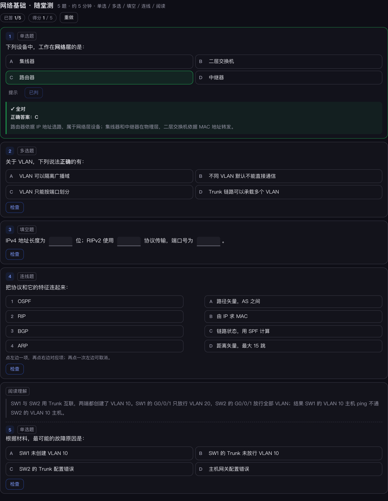

# Study Quiz Widgets

A Hermes skill that turns “quiz me” into a clickable, self-grading widget — plus a paper mode that stays silent until the whole exam is submitted.



## What it does

- **Five objective types** — single choice, multiple choice, fill-in-the-blank, matching and reading comprehension — with answers embedded in the widget and instant checking.
- **Diagram questions** — inline SVG for geometry, network topology and flowcharts; the written solution is sent to Hermes for rubric grading, with self-assessment as an optional extra.
- **Practice mode** — per-question check, partial credit (0.5 for a missed multi-select, per-pair credit for matching), explanations, score bar and “wrong answers again”.
- **Paper mode** (`mode: "paper"`) — no hints, no answers, no right/wrong marks; one submit button at the bottom; objective answers graded from the built-in key, diagram answers by rubric, feedback in chat.
- **Theme-aware** — every colour comes from the injected `--foreground / --muted-foreground / --border / --accent` tokens; semantic green/red/amber are low-alpha; checkboxes are drawn by the widget; no white panels in dark mode.
- **Talkback without losing long answers** — `window.hermes.send` is capped at 500 chars, so the full paper goes to the clipboard and a compact digest asks Hermes to `pbpaste` it. If the bridge refuses, a read-only copy box appears instead of a fake “submitted”.

## Install

```bash
hermes skills install Tangtangchannel/study-quiz-widgets
```

Or clone it into the skills directory:

```bash
git clone https://github.com/Tangtangchannel/study-quiz-widgets.git \
  ~/.hermes/skills/education/study-quiz-widgets
```

## Quick start

1. Copy `templates/quiz.html` to `~/.hermes/widgets/`.
2. Replace the `QUIZ` object; keep the renderers.
3. Output the file with `::preview{file="/abs/path.html"}` alone on its own line.
4. For a paper, add `mode: "paper"` and set `file` to the widget's absolute path.

Minimal data:

```js
const QUIZ = {
  mode: "practice",
  file: "/Users/you/.hermes/widgets/vlan-quiz.html",
  title: "VLAN 随堂测",
  questions: [
    { type: "single", stem: "…", options: ["…", "…", "…", "…"], answer: 2 },
    { type: "multi", stem: "…", options: ["…", "…", "…"], answers: [0, 2] },
    { type: "fill", stem: "IPv4 是 {{}} 位", blanks: [{ a: ["32"], w: 4 }] },
    { type: "match", pairs: [["OSPF", "链路状态"], ["RIP", "距离矢量"]] },
    { type: "reading", passage: "…", questions: [{ type: "single", stem: "…", options: ["…", "…"], answer: 0 }] },
    { type: "diagram", svg: "<svg …>…</svg>", reference: "…", rubric: [{ t: "…", s: 2 }] }
  ]
};
```

## Files

- `SKILL.md` — procedure, question-design rules, grading semantics, verification and pitfalls.
- `templates/quiz.html` — the practice/paper engine (all question types).
- `templates/diagram-question.html` — a single diagram question with model grading and optional self-check.
- `references/presets.md` — copy-paste data for each question type.
- `references/grading.md` — scoring, answer normalization and talkback constraints.
- `references/svg-recipes.md` — geometry, circle, parabola, topology and flowchart SVGs.

## Talkback limits

`window.hermes.send()` caps prompts at `window.hermes.maxLength` (500 by default) and returns `{ ok, error }`. The templates:

- write the full payload to the clipboard;
- send a ≤500-char digest (question numbers + answers + file path);
- ask Hermes to read the clipboard (`pbpaste` on macOS, `xclip -o` / `Get-Clipboard` elsewhere) and the source HTML for the keys;
- show a read-only copy box and an honest failure state if the bridge refuses.

Check the returned `ok` before showing “submitted”; a resolved `{ok:false}` is not a delivery.

The skill body is in Chinese, matching the study context it was built for; the code and data format are language-neutral.

## License

MIT
